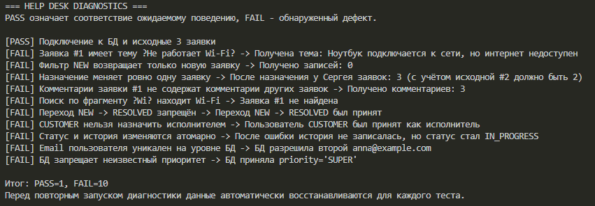
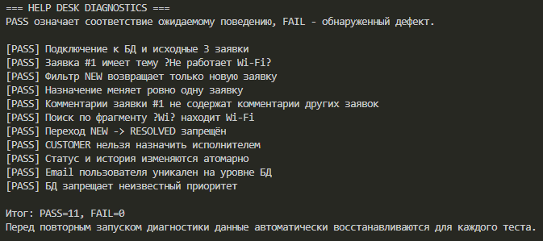

# Отчёт по Help Desk Debug Lab

**ФИО:** Миронов Глеб Максимович 
**Группа:** 2024-ФГиИБ-ИБ-2б
**Вариант самостоятельной работы:** A — SLA и просроченные заявки

## 1. Окружение

- Java: Microsoft OpenJDK 17.0.20.1 LTS.
- Maven: 3.10.0.
- Docker: 29.8.2 (Docker Desktop 4.95.0).
- Docker Compose: 5.6.0.
- PostgreSQL: 18.6.

## 2. Схема БД

| Связь | Тип | Внешний ключ |
|---|---|---|
| Отдел → пользователи | 1:N | `users.department_id → departments.id` |
| Пользователь → заявки как автор | 1:N | `tickets.author_id → users.id` |
| Пользователь → заявки как исполнитель | 1:N | `tickets.assignee_id → users.id` |
| Категория → заявки | 1:N | `tickets.category_id → categories.id` |
| Заявка → комментарии | 1:N | `ticket_comments.ticket_id → tickets.id` |
| Заявка → история статусов | 1:N | `ticket_status_history.ticket_id → tickets.id` |

Внешний ключ находится на стороне «многие»: каждая такая строка ссылается на одну родительскую запись. Например, у заявки может быть несколько комментариев, поэтому `ticket_id` хранится в таблице комментариев. Автор заявки обязателен; исполнитель и категория могут отсутствовать (`NULL`).

## 3. Исходная диагностика

До исправлений: **1 PASS / 10 FAIL**. Подключение к БД и исходные данные прошли проверку; остальные десять проверок выявили дефекты.



## 4. Найденные дефекты

Сначала я воспроизводил ошибку через меню и пытался определить, затрагивает ли она только выбранную операцию или проявляется в других сценариях. Затем находил соответствующую команду в `Main` и прослеживал вызовы до конкретного метода модели, Service или Repository. После первых двух-трёх исправлений стало проще замечать повторяющиеся причины: неверное поле в SQL, отсутствие фильтра или проверки бизнес-правила.

В таблице указаны сценарии автоматического воспроизведения из `Diagnostics` и результаты итоговой диагностики.

| № | Симптом | Воспроизведение | Причина | Файл и исправление | Проверка |
|---|---|---|---|---|---|
| 1 | Вместо темы заявки выводилось её описание. | `mappingTitle()`: прочитать тему заявки №1. | В `mapTicket()` в аргумент `title` передавался столбец `description`. | `JdbcTicketRepository.java`: для темы используется `rs.getString("title")`. | Тема заявки №1 — «Не работает Wi-Fi»; PASS. |
| 2 | Фильтр `NEW` возвращал пустой список. | `statusFilter()`: запросить заявки со статусом `NEW`. | Статус сравнивался со столбцом `priority`. | `JdbcTicketRepository.java`: условие заменено на `WHERE status = ?`. | Найдена одна заявка — №1; PASS. |
| 3 | Назначение исполнителя меняло все заявки. | `assignmentTouchesOneTicket()`: назначить заявку №1 Сергею (id=2), затем подсчитать его заявки. | В `UPDATE` отсутствовало условие `WHERE`. | `JdbcTicketRepository.java`: добавлены `WHERE id = ?` и передача `ticketId` во второй параметр. | У Сергея две заявки с учётом исходной №2, а не три; PASS. |
| 4 | Для заявки №1 показывались комментарии других заявок. | `commentsAreFiltered()`: получить комментарии заявки №1. | Запрос выбирал все строки из `ticket_comments`. | `JdbcCommentRepository.java`: добавлены `WHERE ticket_id = ?` и передача ID заявки. | Возвращён один комментарий, относящийся к заявке №1; PASS. |
| 5 | По фрагменту `Wi` заявка про Wi-Fi не находилась. | `partialSearch()`: выполнить поиск `Wi`. | Оператор `=` требовал полного совпадения заголовка; `LOWER` менял только регистр. | `JdbcTicketRepository.java`: используется `LIKE` и параметр `"%" + query + "%"`; `LOWER` сохранён с обеих сторон. | Среди результатов есть заявка №1; PASS. |
| 6 | Разрешался прямой переход `NEW → RESOLVED`. | `invalidTransitionRejected()`: попытаться перевести заявку №1 сразу в `RESOLVED`. | В модели этот переход был включён в список допустимых. | `Ticket.java`: из переходов состояния `NEW` удалён `RESOLVED`, оставлен `IN_PROGRESS`. | Операция отклоняется с `IllegalStateException`; PASS. |
| 7 | Пользователя с ролью `CUSTOMER` можно было назначить исполнителем. | `customerCannotBeAssignee()`: назначить Анну (id=1) на заявку №1. | Service проверял существование пользователя, но не его роль. | `TicketService.java`: результат поиска сохранён в `assignee`; перед назначением добавлена проверка роли и `IllegalArgumentException` для `CUSTOMER`. | Назначение отклоняется до вызова `tickets.assign()`; PASS. |
| 8 | После ошибки записи истории новый статус сохранялся. | `statusChangeIsAtomic()`: изменить статус с `changedBy=9999`, затем повторно прочитать заявку. | Запросы выполнялись через разные соединения с автоматической фиксацией: ошибка записи истории не отменяла уже сохранённый статус. | `JdbcTicketRepository.java`: оба запроса объединены одной транзакцией на одном `Connection`; autoCommit отключён, `commit()` сохраняет оба изменения, `rollback()` отменяет их при ошибке. | После нарушения внешнего ключа в истории статус заявки №1 остаётся `NEW`; PASS. |
| 9 | БД допускала пользователей с одинаковым email. | `emailIsUnique()`: вставить второго пользователя с `anna@example.com`. | В схеме отсутствовало ограничение уникальности email. | `db/init/01_schema.sql`: к `users.email` добавлено `UNIQUE`; БД пересоздана для применения схемы. | Повторная вставка отклоняется БД; PASS. |
| 10 | БД принимала неизвестный приоритет `SUPER`. | `priorityIsConstrained()`: выполнить прямую SQL-вставку заявки с `priority='SUPER'`. | `VARCHAR(20) NOT NULL` не ограничивал множество значений. Enum ограничивает значения в Java, но прямой SQL обходит модель, поэтому БД нужна собственная проверка. | `db/init/01_schema.sql`: добавлен `CHECK` с `LOW`, `MEDIUM`, `HIGH`, `CRITICAL`; БД пересоздана для применения схемы. | Вставка `SUPER` отклоняется БД; PASS. |

## 5. Итоговая диагностика

После исправлений: **11 PASS / 0 FAIL**. Все базовые диагностические проверки пройдены.



## 6. Самостоятельное улучшение

### Постановка задачи

Добавлен контроль срока выполнения заявки. При создании заявки срок отсчитывается от текущего момента: `CRITICAL` — 1 час, `HIGH` — 4 часа, `MEDIUM` — 8 часов, `LOW` — 24 часа. Заявка считается просроченной, если `due_at` строго меньше текущего времени и статус не равен `RESOLVED` или `CLOSED`.

### Изменения схемы БД

| Объект | До SLA | После SLA |
|---|---|---|
| `tickets.due_at` | Поле отсутствовало | `TIMESTAMPTZ NOT NULL`: обязательный срок с учётом часового пояса |
| Индекс просроченных заявок | Отсутствовал | `idx_tickets_overdue` по `(due_at, id)` только для незавершённых заявок |
| Связи таблиц | Шесть таблиц с существующими внешними ключами | Не изменились |

Обновлены `db/init/01_schema.sql` и начальные данные в `db/init/02_seed.sql`. Для существующей БД добавлена миграция `db/migrations/01_add_ticket_sla.sql`: она заполняет сроки старых заявок на основе `created_at` и приоритета, сохраняет данные и допускает повторный запуск. На текущей БД миграция применена без сброса таблиц.

Индекс соответствует условиям выборки: завершённые заявки в него не входят, а сортировка по сроку помогает искать и выводить сначала наиболее ранние просрочки.

### Изменения Java-кода

| Слой | Изменение |
|---|---|
| Model | В `Ticket` добавлены `OffsetDateTime dueAt`, getter и вывод срока в местном часовом поясе. |
| Service | `TicketService.createTicket()` рассчитывает срок по приоритету; `findOverdue()` передаёт текущее время в Repository. Для воспроизводимой диагностики можно передать `Clock`. |
| Repository | Контракт создания принимает рассчитанный срок; добавлен `findOverdue(OffsetDateTime now)`. |
| JDBC | Срок записывается и читается через `PreparedStatement`/`ResultSet`; запрос фильтрует `due_at < ?`, исключает `RESOLVED`/`CLOSED` и сортирует по `due_at, id`. |
| Консоль | Добавлена команда `10`; при отсутствии просрочек выводится соответствующее сообщение. |

Расчёт SLA находится в Service, поскольку соответствие приоритета сроку — бизнес-правило. Repository получает готовые значения и отвечает за сохранение и SQL-выборку. Расчёт при заполнении старых данных в миграции выполняется однократно и не заменяет правило в Service.

В базовой диагностике обновлены только SQL-вставки: они теперь заполняют обязательное поле `due_at`. Условия и ожидаемые результаты всех 11 проверок сохранены. В `pom.xml` настроен выбор запускаемого класса через `exec.mainClass`.

### Новые команды/сценарии

1. Создать заявку командой `9`: срок рассчитывается автоматически и отображается в результате.
2. Выбрать команду `10`: получить просроченные открытые заявки в порядке срока.
3. Перевести просроченную заявку через `IN_PROGRESS` в `RESOLVED`: она исчезнет из списка просроченных. `CLOSED` также исключается.

### Новые диагностические проверки

Добавлен отдельный класс `SlaDiagnostics`:

| № | Проверка | Результат |
|---|---|---|
| 1 | Сроки для всех четырёх приоритетов — 1/4/8/24 часа; срок сохраняется при повторном чтении из БД. | PASS |
| 2 | Просроченные `NEW` и `IN_PROGRESS` включаются; будущий срок и срок, равный текущему времени, исключаются; более ранний срок выводится первым. | PASS |
| 3 | `RESOLVED` и `CLOSED` исключаются даже при истёкшем сроке. | PASS |
| 4 | При смене статуса просроченная заявка остаётся в списке в `IN_PROGRESS`, затем исчезает в `RESOLVED` и `CLOSED`. | PASS |

Проверки выполняются с фиксированным временем и удаляют только созданные ими временные заявки. Сборка и обе диагностики проверены на отдельной временной БД, созданной по актуальным init-скриптам. Дополнительно проверены команды меню `9` и `10`, включая пустой список просрочки, и повторный запуск миграции.

```text
Базовая диагностика: PASS=11, FAIL=0
Диагностика SLA:     PASS=4, FAIL=0
```

Запуск из PowerShell:

```powershell
mvn compile
mvn exec:java "-Dexec.mainClass=edu.helpdesk.SlaDiagnostics"
```

## 7. Вывод

Сложнее всего было в начале, когда я ещё разбирался в структуре проекта и не понимал, на каком уровне искать причину ошибки. После исправления первых двух-трёх дефектов стала понятна общая тенденция: неверные условия SQL-запросов, пропущенные проверки и ошибки при работе с данными. Дальше поиск шёл проще: я воспроизводил проблему через меню, находил соответствующий вызов в `Main` и прослеживал его до места возникновения ошибки. Главный результат работы - понимание того, как связать наблюдаемый симптом с конкретной причиной и подтвердить исправление диагностикой.
